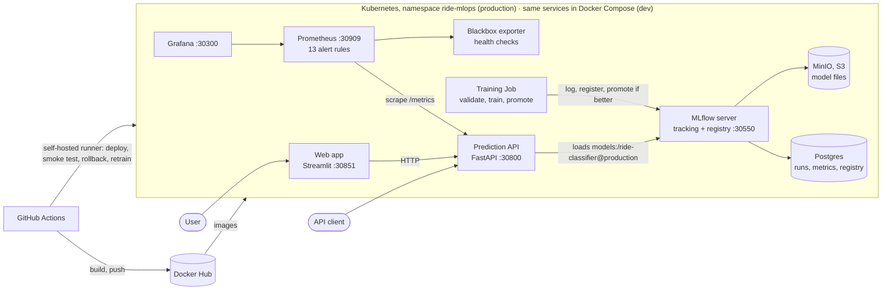
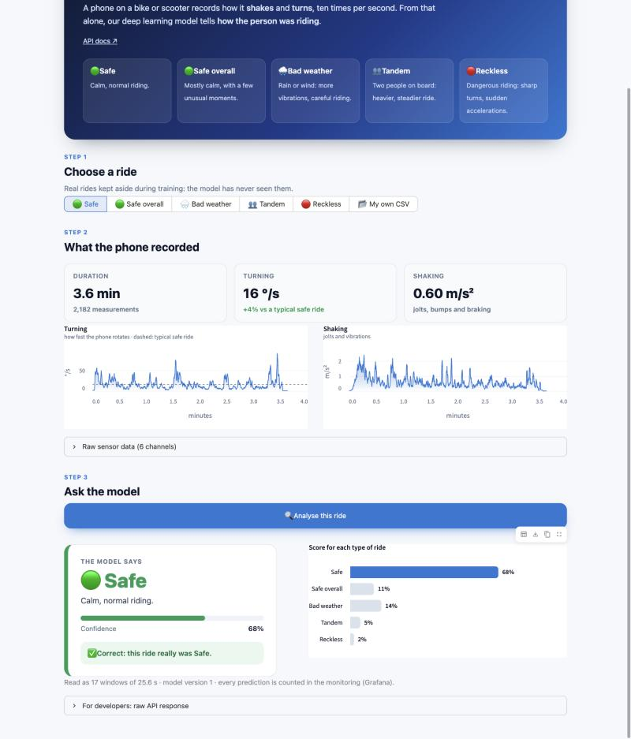
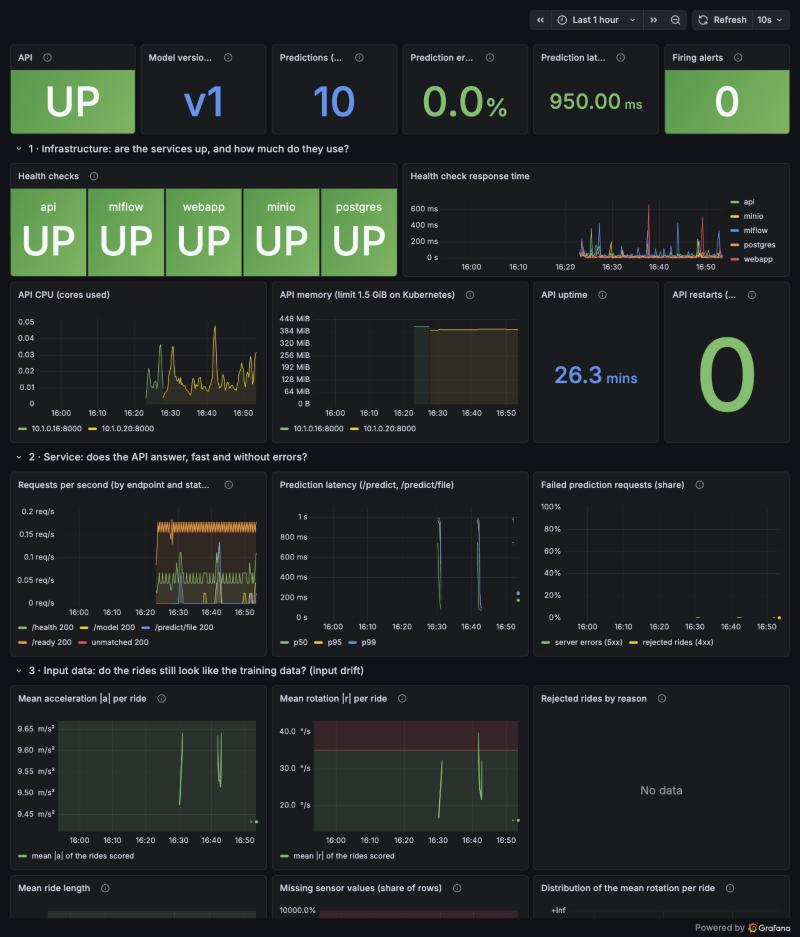
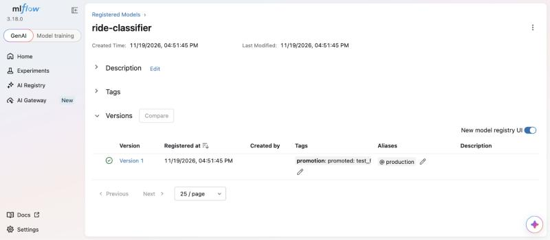
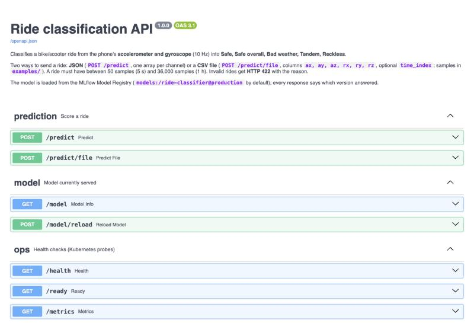
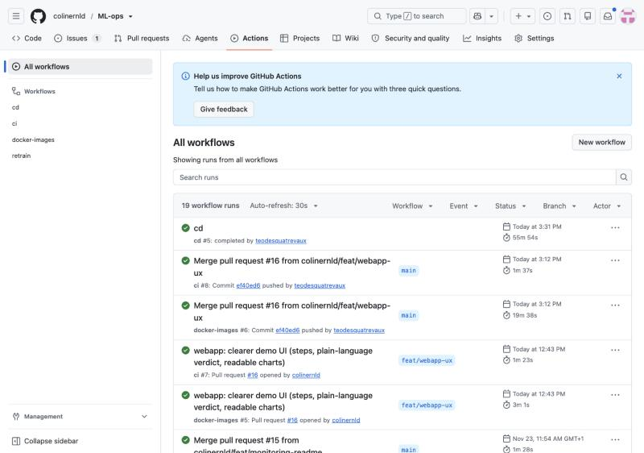
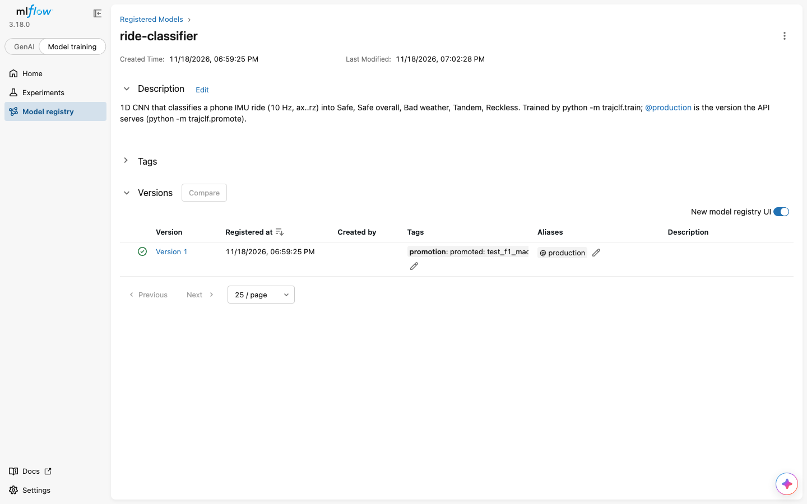
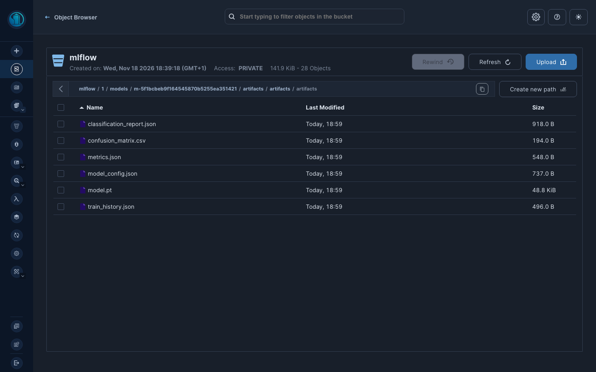
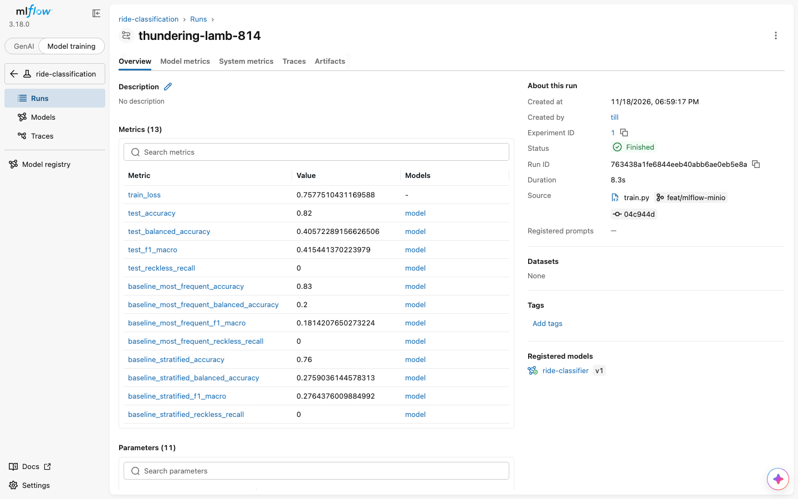
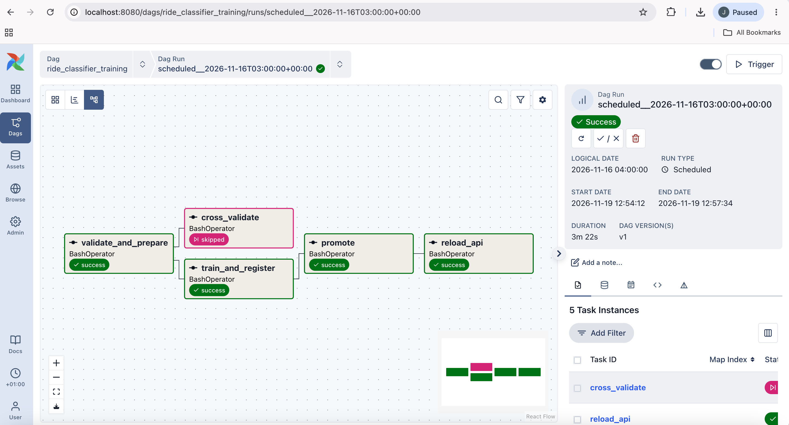

# Ride classifier: an MLOps pipeline for phone IMU rides

[](https://github.com/colinernld/ML-ops/actions/workflows/ci.yml)
[](https://github.com/colinernld/ML-ops/actions/workflows/docker-images.yml)
[](https://github.com/colinernld/ML-ops/actions/workflows/cd.yml)

A deep learning model classifies a bike/scooter ride, from the phone's accelerometer and gyroscope (10 Hz),
into **Safe, Safe overall, Bad weather, Tandem, Reckless**. Around it, the full MLOps lifecycle: data
validation, experiment tracking and model registry (MLflow, models on S3/MinIO), a prediction API and a web
app, Docker images, CI/CD to Kubernetes, a retraining pipeline and monitoring.

MLOps course project, Albert School, group of 5 ([team](#team-and-collaboration)).

| | |
|---|---|
| **Model** | 1D CNN (~10.6k parameters) on orientation-robust features; ride score = mean over 25.6 s windows |
| **Result** | balanced accuracy **0.44** vs 0.27 (random) and 0.20 ("always Safe"), 5-fold CV on 500 rides |
| **Dev** | Docker Compose: MLflow + Postgres + MinIO, API, web app (+ Airflow and monitoring profiles) |
| **Production** | Kubernetes (Docker Desktop): the same services + Prometheus/Grafana, deployed by GitHub Actions |
| **Quality** | 65 pytest tests + alert-rule unit tests, lint, manifest checks on every pull request |

## Contents

[Architecture](#architecture) · [Objectives → where](#project-objectives-and-where-to-find-them) ·
[Quick start](#quick-start-dev) · [Production](#production-kubernetes) · [CI/CD](#cicd) ·
[Results](#results) · [Technical choices](#technical-choices) · [Screenshots](#screenshots) ·
[Docker Hub](#docker-hub-images) · [Tests](#tests) · [Layout](#repository-layout) · [Docs](#documentation) ·
[Team](#team-and-collaboration) · [Limits](#limitations-and-next-steps)

## Architecture



Lifecycle of a model:

```
raw rides ─▶ validate (stop on bad data) ─▶ clean + split ─▶ train CNN ─▶ log run + register version (MLflow, files in MinIO)
          ─▶ promote to @production only if it beats the baselines AND the current production model
          ─▶ API reloads @production (version returned with every prediction) ─▶ monitored (Prometheus + Grafana)
          ─▶ drift alert ─▶ retrain (GitHub Actions or Airflow) ─▶ ...
```

## Project objectives and where to find them

| Objective (project brief) | How | Where |
|---|---|---|
| 1. Extract the data | GBG500 parquet + labels from Inside; **validated** (schema, 10 Hz sampling, missing values, physical ranges, labels) before any training | [`src/trajclf/data.py`](src/trajclf/data.py), [`validation.py`](src/trajclf/validation.py), [docs/data.md](docs/data.md) |
| 2. Deep learning classifier (5 classes) | PyTorch 1D CNN, balanced sampling, compared with two baselines | [`src/trajclf/`](src/trajclf), [model card](docs/model_card.md), [experiments](docs/experiments.md) |
| 3. Model stored on S3 (MinIO) | MLflow artifact store = MinIO bucket `mlflow` (model weights, config, reports) | [`docker-compose.yml`](docker-compose.yml), [`k8s/minio.yaml`](k8s/minio.yaml), [docs/mlflow.md](docs/mlflow.md) |
| 4. Track experiments and models with MLflow | every run (params, metrics vs baselines, environment, git commit), 5-fold CV runs, registry with `@production` / `@previous` aliases and an automatic promotion gate | [`train.py`](src/trajclf/train.py), [`promote.py`](src/trajclf/promote.py), [docs/mlflow.md](docs/mlflow.md) |
| 5. API: send a ride, get a prediction | FastAPI with Swagger, JSON or CSV input, validation errors as HTTP 422, model version in every answer | [`src/api/`](src/api), [docs/api.md](docs/api.md) |
| Interactive web app | Streamlit, thin client of the API (no model inside) | [`webapp/app.py`](webapp/app.py) |
| 6. Dockerize and deploy on Kubernetes with GitHub Actions | 3 images on Docker Hub (multi-arch), Kubernetes manifests, CD on a self-hosted runner with smoke test and automatic rollback | [`docker/`](docker), [`k8s/`](k8s), [`.github/workflows/`](.github/workflows), [docs/kubernetes.md](docs/kubernetes.md), [docs/cicd.md](docs/cicd.md) |
| Pipeline / workflow DAG | Airflow DAG validate → train → promote if better → reload API | [`dags/`](dags), [docs/pipeline.md](docs/pipeline.md) |
| 7. Version and document on GitHub | protected `main`, one branch + pull request + review per change, issues, CI on every PR, docs per part | [CONTRIBUTING.md](CONTRIBUTING.md), [docs/](docs) |
| Bonus: retraining pipeline in GitHub Actions | get data → validate → retrain → promote if better → redeploy; manual, weekly or on drift | [`retrain.yml`](.github/workflows/retrain.yml), [docs/cicd.md](docs/cicd.md#retraining-workflow) |
| Bonus: monitoring | Prometheus + Grafana in 4 layers (infrastructure, service, input data, model), 13 tested alert rules, drift simulator | [`monitoring/`](monitoring), [docs/monitoring.md](docs/monitoring.md) |
| Bonus: feature store | not done: features are computed on the fly by the same code in training and serving ([limits](#limitations-and-next-steps)) | – |

## Quick start (dev)

Requires Docker Desktop. The data (`Project.zip` on Inside) goes in `data/raw/` (`GBG500.parquet`,
`GBG500_labels.csv`) and is never committed.

```bash
cp .env.example .env                               # then change the passwords
docker compose up -d --build                       # MLflow, MinIO, Postgres, API, web app
docker compose --profile monitoring up -d          # + Prometheus, Grafana
docker compose --profile airflow up -d             # + Airflow (training pipeline)
```

| Service | URL |
|---|---|
| Web app | http://localhost:8501 |
| API (Swagger) | http://localhost:8000/docs |
| MLflow | http://localhost:5050 |
| MinIO console | http://localhost:9001 |
| Grafana / Prometheus | http://localhost:3000 / http://localhost:9090 |
| Airflow | http://localhost:8080 |

Train, register and promote a first model (Python 3.10+), then let the API load it:

```bash
pip install -e ".[dev,mlflow,api]"
export MLFLOW_TRACKING_URI=http://localhost:5050 API_URL=http://localhost:8000
python -m trajclf.pipeline all          # validate + prepare → train + register → promote if better → reload API
# or trigger the DAG "ride_classifier_training" in Airflow
```

Try it: open the web app and pick a sample ride, or

```bash
curl -F "file=@examples/ride_safe.csv" http://localhost:8000/predict/file
python scripts/simulate_traffic.py      # traffic for the Grafana dashboard (add --drift units to see an alert)
```

Without Docker, every part also runs from Python: `python -m trajclf.data`, `python -m trajclf.train`,
`python -m trajclf.evaluate` (5-fold CV), `uvicorn api.main:app --app-dir src`, `streamlit run webapp/app.py`
(see [docs/api.md](docs/api.md) and [docs/mlflow.md](docs/mlflow.md)). Hyper-parameters live in
[`params.yaml`](params.yaml).

## Production (Kubernetes)

Production is the Kubernetes cluster of Docker Desktop on the team's production Mac, namespace `ride-mlops`
(manifests in [`k8s/`](k8s) and [`monitoring/`](monitoring), plain YAML + kustomize). First deployment and
operations: [docs/kubernetes.md](docs/kubernetes.md).

| Service | Production URL |
|---|---|
| Web app | http://localhost:30851 |
| API (Swagger) | http://localhost:30800/docs |
| MLflow | http://localhost:30550 |
| MinIO console | http://localhost:30901 |
| Grafana (monitoring dashboard) | http://localhost:30300 |
| Prometheus (alerts) | http://localhost:30909/alerts |

Postgres and MinIO keep their data on persistent volumes; passwords are in a Secret created from `.env`
(`k8s/create-secrets.sh`), never in git. The API is *ready* only when a model is loaded, and rolling updates keep
the old pods until the new ones are ready (zero-downtime deploys).

## CI/CD

```
pull request ─▶ ci: ruff, pytest, hadolint, kubeconform, promtool (configs + alert tests), compose config
             └▶ docker-images: build the 3 images, start the API and web app, hit their health checks
             ─▶ review + approval ─▶ squash merge to main
main ─▶ docker-images: build amd64 + arm64, push to Docker Hub (latest + sha-<commit>)
     └▶ cd (self-hosted runner on the production Mac): kubectl apply -k k8s/ → images sha-<commit>
        → rollout → smoke test (MLflow, API /ready + a real prediction, web app) → automatic rollback on failure
retrain (manual, weekly or on drift): data → validate → train → register → promote if better → API restarted
```

Every deployment is traceable (`kubectl rollout history` shows the image tag and commit) and can be rolled back
to any published version (Actions → *cd* → *Run workflow* with `sha-<commit>`). Details: [docs/cicd.md](docs/cicd.md).

## Results

The dataset is very imbalanced (416 Safe, 38 Safe overall, 22 Bad weather, 18 Tandem, **6 Reckless**): always
answering "Safe" already gets 83 % accuracy. The model is therefore judged on **balanced accuracy** and
**macro-F1**, against two baselines computed on the same folds.

5-fold cross-validation, 500 rides (mean ± std):

| Metric | CNN | Always "Safe" | Random (class frequencies) |
|---|---|---|---|
| Balanced accuracy | **0.44 ± 0.17** | 0.20 | 0.27 ± 0.04 |
| Macro-F1 | **0.36 ± 0.12** | 0.18 | 0.26 ± 0.04 |
| Accuracy | 0.69 ± 0.08 | 0.83 | 0.75 |

- The model **beats both baselines** on the metrics that matter for imbalanced data. Its plain accuracy is
  below "always Safe" on purpose: it trades a few Safe rides for catching rare classes.
- 9 variants were compared with the same CV ([experiments](docs/experiments.md)): the first model predicted
  "Safe" for every ride (it recognised rides, not riding styles) until we removed the phone orientation from
  the signals; 25 epochs gave the best and most stable scores.
- On the real data run logged in MLflow, the hold-out macro-F1 is 0.42 vs 0.18 ("always Safe") and 0.28
  (random) ([screenshot](docs/figures/mlflow_training_run.png)).
- **Limits**: Reckless recall is not reliable (1 Reckless ride per test fold); scores move by ±0.1 with the
  PyTorch version and platform (every run is tagged with its environment, see the
  [model card](docs/model_card.md#reproducibility-across-environments)). Demo rides: Safe, Safe overall and Bad
  weather are classified correctly, Tandem and Reckless are not ([examples/demo_rides.json](examples/demo_rides.json)).

## Technical choices

| Choice | Why |
|---|---|
| **1D CNN on orientation-robust features** (median removed per axis, \|a\| and \|r\|), windows of 25.6 s | the phone is mounted differently on every ride: raw axes made the model memorise rides. Small model (10.6k parameters) for 500 rides, trains in ~1 min on a CPU |
| **Balanced accuracy / macro-F1 + baselines** | accuracy is misleading at 83 % Safe; every number is compared with "always Safe" and random |
| **Validation shared by training and serving** (`validate_ride`) | the API rejects exactly what the pipeline would reject, with the same messages (HTTP 422) |
| **MLflow server with Postgres + MinIO**, artifacts proxied | clients only need `MLFLOW_TRACKING_URI`, no S3 credentials leave the server; same setup in Compose and Kubernetes |
| **Registry alias `@production` + automatic promotion gate** | the API never hard-codes a version; a new model reaches production only if it beats the baselines and the current model; `@previous` makes rollback one command |
| **FastAPI**, synchronous inference endpoints | Swagger for free, typed request/response models; PyTorch is CPU-bound, so it runs in the thread pool |
| **API starts without a model** (`/health` vs `/ready`) | on Kubernetes the API can start before MLflow; it becomes ready as soon as the model loads |
| **Streamlit as a thin client** | the web app shows exactly what production answers; its image needs no PyTorch |
| **One image per service, CPU-only PyTorch, non-root, model not in the image** | small images, same image in Compose and Kubernetes; a new model needs no new image |
| **Plain manifests + kustomize** rather than Helm charts | everything readable in one folder, validated by kubeconform in CI, `kubectl apply -k` needs no extra tool |
| **Self-hosted runner for CD** | the cluster is on a laptop, unreachable from GitHub; the runner pulls jobs, so nothing is exposed. PR code never runs on it |
| **Immutable `sha-<commit>` tags + automatic rollback** | every deployment can be traced to a commit and undone |
| **Pipeline steps as plain functions** (`trajclf.pipeline`) called by Airflow *and* GitHub Actions | one source of truth, tested without Airflow |
| **Prometheus + Grafana, metrics computed in the API** | 4 layers (infrastructure, service, input data, model); without labels in production, quality is watched through input drift, output drift and confidence |
| **Monitoring as code** | dashboard JSON and alert rules in git, provisioned at startup, unit-tested by `promtool` in CI |

## Screenshots

### Production (Kubernetes on the team laptop)

| Web app: a sample ride classified by the `@production` model | Grafana: service up, model version, no alert firing |
|---|---|
|  |  |
| **MLflow registry: `ride-classifier` v1 trained in the cluster, alias `@production`** | **API documentation (Swagger) served by the production API** |
|  |  |
| **GitHub Actions: CI, Docker Hub build and CD to the cluster all green** | |
|  | |

### Development

| MLflow registry: `@production` alias and promotion reason | Model files in the MinIO bucket |
|---|---|
|  |  |
| **Training run: test metrics vs baselines** | **Airflow DAG: validate → train → promote → reload** |
|  |  |

More in [docs/mlflow.md](docs/mlflow.md), [docs/data.md](docs/data.md) and [docs/pipeline.md](docs/pipeline.md).

## Docker Hub images

Built and pushed by GitHub Actions on every merge to `main` (tags `latest` and `sha-<commit>`, `linux/amd64` +
`linux/arm64`):

| Image | Docker Hub | Content |
|---|---|---|
| API | https://hub.docker.com/r/colinernld/ride-api | FastAPI + PyTorch (CPU) + MLflow client + `trajclf` |
| Web app | https://hub.docker.com/r/colinernld/ride-webapp | Streamlit + sample rides |
| MLflow server | https://hub.docker.com/r/colinernld/ride-mlflow | MLflow 3.18 + Postgres and S3 drivers |

Prometheus, Grafana, the blackbox exporter, Postgres and MinIO use their official images, pinned to a version.

## Tests

```bash
pip install -e ".[dev,mlflow,api]"
ruff check . && pytest                  # 65 tests, synthetic data: the real dataset is not needed
```

| File | What it checks |
|---|---|
| `test_validation.py`, `test_data_model.py`, `test_pipeline.py` | data rules, preprocessing, windows, model, training end to end |
| `test_promote.py`, `test_pipeline_dag.py`, `test_airflow_dag.py` | promotion rule, pipeline steps against a local MLflow registry, DAG structure (needs Airflow) |
| `test_api.py`, `test_demo_rides.py` | every endpoint and error case, loading `@production` from MLflow then promoting and reloading |
| `test_monitoring.py`, `test_simulate_traffic.py` | the dashboard and alerts only use metrics the API exposes, every alert tested and documented, drift scenarios |
| `monitoring/prometheus/alerts_test.yml` | `promtool test rules`: each alert fires on its scenario, none fires on normal traffic |

CI also lints the Dockerfiles (hadolint), validates the rendered Kubernetes manifests (kubeconform), the
Prometheus and blackbox configs and the Compose file, and smoke-tests the images.

## Repository layout

```
src/trajclf/        data validation, preprocessing, CNN, training, CV, MLflow model, promotion, pipeline steps
src/api/            FastAPI service: /predict, /predict/file, /model, /model/reload, /health, /ready, /metrics
webapp/             Streamlit web app (calls the API)
dags/               Airflow DAG ride_classifier_training
docker/             Dockerfiles: api, webapp, mlflow, airflow
docker-compose.yml  dev environment (profiles: airflow, monitoring)
k8s/                production manifests (kustomize), secrets script, in-cluster training job
monitoring/         Prometheus configs + alert rules (+ tests), Grafana provisioning + dashboard, blackbox, K8s manifests
.github/workflows/  ci, docker-images, cd, retrain
scripts/            EDA, MLflow check, demo ride picker, traffic simulator
tests/              pytest suite
docs/               documentation per part, figures
examples/           one demo ride per class (CSV)
params.yaml         hyper-parameters (single source of truth)
```

## Documentation

| Doc | Content |
|---|---|
| [docs/data.md](docs/data.md) | dataset, exploration figures, data validation rules |
| [docs/model_card.md](docs/model_card.md) | model, training, evaluation, limitations, reproducibility |
| [docs/experiments.md](docs/experiments.md) | every variant tried and why the final one was kept |
| [docs/mlflow.md](docs/mlflow.md) | MLflow + MinIO stack, logging runs, registry, promotion |
| [docs/api.md](docs/api.md) | API endpoints, configuration, design choices, metrics; web app |
| [docs/pipeline.md](docs/pipeline.md) | training pipeline: Airflow DAG and its steps |
| [docs/docker.md](docs/docker.md) | Docker images, Compose dev environment, Docker Hub publishing |
| [docs/kubernetes.md](docs/kubernetes.md) | production on Kubernetes: first deployment, operations, rollback |
| [docs/cicd.md](docs/cicd.md) | GitHub Actions: CI, image publishing, CD with a self-hosted runner, retraining |
| [docs/monitoring.md](docs/monitoring.md) | Prometheus + Grafana: 4 layers, alerts, drift demo |
| [CONTRIBUTING.md](CONTRIBUTING.md) · [CLAUDE.md](CLAUDE.md) | how we work on GitHub · shared project context and status |

## Team and collaboration

| Member | Part |
|---|---|
| Coline ([@colinernld](https://github.com/colinernld)) | data, model, evaluation; repository setup; Kubernetes memory fix and in-cluster training |
| Till Lüder ([@tluder-dot](https://github.com/tluder-dot)) | MLflow + MinIO + Postgres stack, model promotion |
| Jane Galthie ([@jgalthie-sketch](https://github.com/jgalthie-sketch)) | API (FastAPI) and web app (Streamlit), Airflow pipeline, demo rides |
| Téo Desquatrevaux ([@teodesquatrevaux](https://github.com/teodesquatrevaux)) | Docker images, Docker Hub, Kubernetes manifests, CI/CD |
| Benjamin Rasson | monitoring (Prometheus + Grafana), retraining workflow, README, presentation |

How we worked ([CONTRIBUTING.md](CONTRIBUTING.md)): `main` is protected; every change goes through a branch
and a pull request reviewed by another member, with CI green before merging (squash merge). Open questions and
"done when" checklists live in GitHub issues, linked from the PRs (`Closes #N`). [CLAUDE.md](CLAUDE.md) keeps
the shared status, interfaces between the parts and gotchas, updated in each PR.

## Limitations and next steps

- **Data**: 500 rides from one city, 6 Reckless rides. Reckless detection is not reliable yet; more labelled
  rides (other cities, phones) matter more than a bigger model. A self-supervised pre-training on the 3,490
  unlabelled SRV rides is the next modelling idea ([experiments](docs/experiments.md)).
- **Feature store** (bonus, not done): features are cheap and computed on the fly by the same code in training
  and serving. With more data, precomputed windows in a feature store (e.g. Feast) would avoid recomputing them
  at every retraining.
- **Monitoring**: no Alertmanager yet (alerts are shown in Prometheus and Grafana); the next step is to route
  drift alerts to Slack and to the `retrain` workflow, which already accepts a `repository_dispatch` event.
  No ground truth in production: model quality is checked at each retraining, not live.
- **Production on a laptop**: single-node cluster, Prometheus history in an `emptyDir`, NodePorts on `localhost`.
  A cloud deployment would add an ingress with TLS, persistent monitoring storage and several API replicas.
