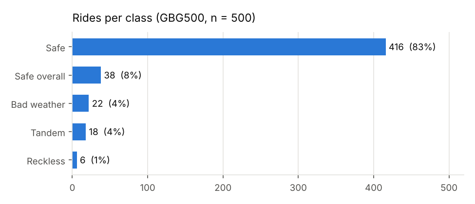
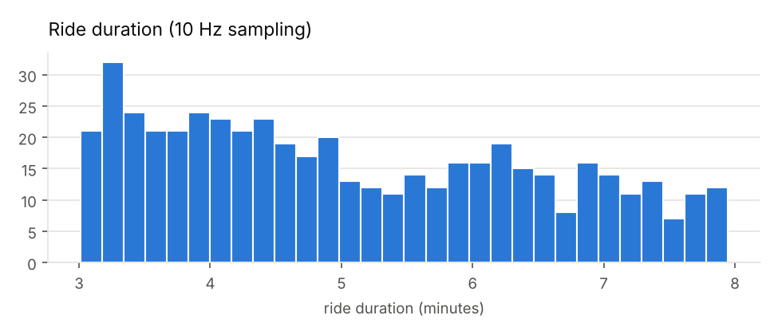
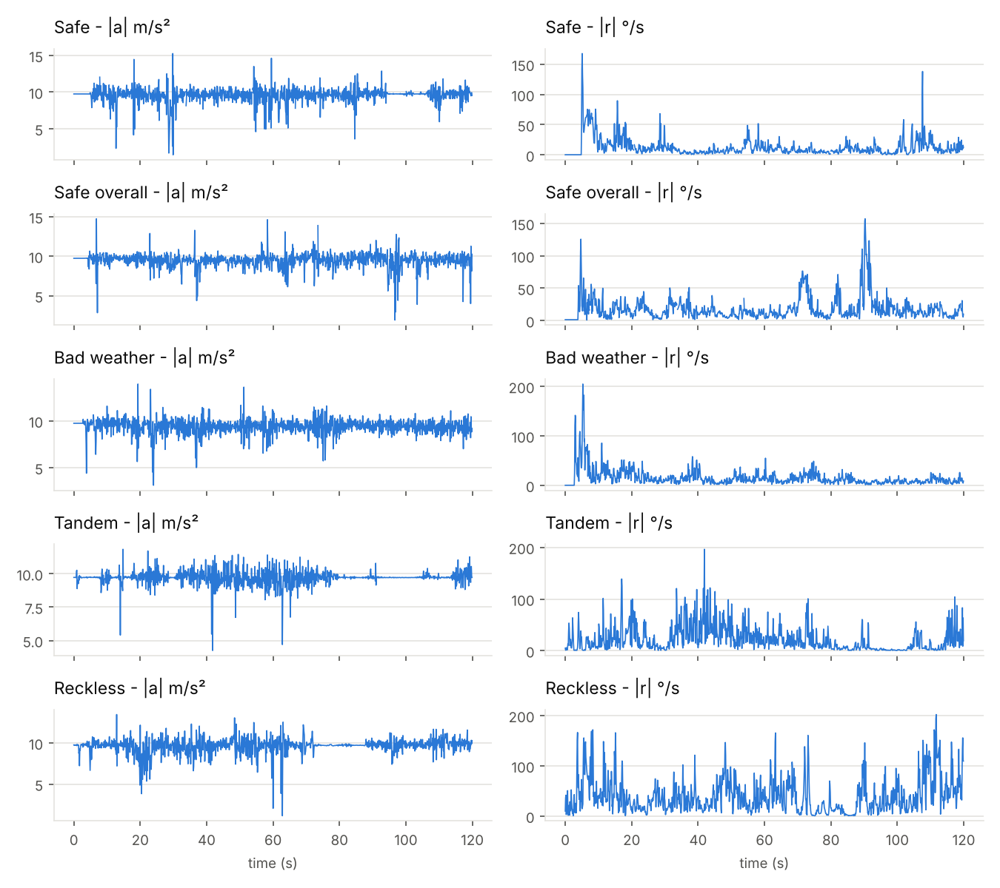

# Data

Source: `Project.zip (data)` on Inside (MLOps & Model Deployment → Materials → Project).
Figures and numbers on this page come from `python scripts/eda.py`.

## Files

| File | Content | Used for |
|---|---|---|
| `GBG500.parquet` | 500 rides in Gothenburg, 1,529,547 rows | training + evaluation |
| `GBG500_labels.csv` | `RIDE_ID, LABEL` for the 500 rides | training + evaluation |
| `SRV3490.parquet` | 3,490 rides in 8 European cities, 698 with a confirmed crash (`topple = 1`) | encoder pre-training (optional) |

Schema of `GBG500.parquet`:

| Column | Type | Meaning |
|---|---|---|
| `ride_id` | string | ride identifier (SHA-256) |
| `time_index` | int | milliseconds since ride start, one row every 100 ms (10 Hz) |
| `ax`, `ay`, `az` | float | accelerometer, m/s² (gravity included) |
| `rx`, `ry`, `rz` | float | gyroscope, °/s (saturates at ±300 °/s) |

## Labels

- **Reckless** is the class we really want to detect.
- **Safe** rides are normal riding.
- **Safe overall, Bad weather, Tandem** are "counterfactual" rides: unusual but legitimate,
  close to the decision boundary, and should *not* be flagged as reckless.

With 83 % of rides labelled *Safe*, accuracy is misleading (always answering "Safe" scores 83 %).
We report **balanced accuracy** and **macro-F1** and compare to baselines (see the model card).

## Rides

- 1,807 – 4,767 samples per ride (3 – 8 minutes, median 4.8 min).
- 10,201 rows (0.7 %) have missing sensor values, spread over 439 rides → linear interpolation.
- Most rides start with a few seconds where the phone is still (flat signal).

Median per-ride statistics (norm of acceleration |a| and rotation |r|):

| Class | Duration (min) | std(\|a\|) | mean(\|r\|) °/s | p99(\|r\|) °/s |
|---|---|---|---|---|
| Safe | 4.9 | 0.93 | 15.5 | 74 |
| Safe overall | 4.8 | 0.96 | 21.4 | 94 |
| Bad weather | 4.9 | 0.86 | 15.6 | 74 |
| Tandem | 4.4 | 0.71 | 16.6 | 72 |
| **Reckless** | 5.7 | **1.38** | **33.9** | **139** |

Reckless rides rotate about twice as much as the others: a strong signal, but only 6 examples.
Bad weather and Tandem look very close to Safe on these simple statistics, which is why they are
the hardest classes.

## Phone orientation

Gravity (≈ 9.8 m/s²) appears on different axes depending on how the phone is mounted
(e.g. `ay ≈ -9.4` on one ride, spread across axes on another). A model fed raw axes learns to
recognise *rides* instead of *riding styles*. Preprocessing therefore removes each ride's median
per axis and adds the norms |a| and |r|, which do not depend on orientation (see `features.py`).

## Data validation

`trajclf.validation` runs before every training (`python -m trajclf.data`) and on every ride sent
to the model. The pipeline stops if a check fails; the report is saved to
`data/processed/validation_report.json`.

| Check | Rule |
|---|---|
| Schema | columns `ride_id, time_index, ax..rz` present and numeric |
| Sampling | ≥ 99 % of time steps equal to 100 ms |
| Missing values | ≤ 5 % of rows (dataset), ≤ 20 % (single ride) |
| Physical range | \|a\| ≤ 16 g, \|r\| ≤ 2000 °/s, no infinity |
| Ride length | 50 – 36,000 samples (5 s – 1 h) for inference |
| Labels | known class names, unique ride ids, every ride labelled and every label matched |
