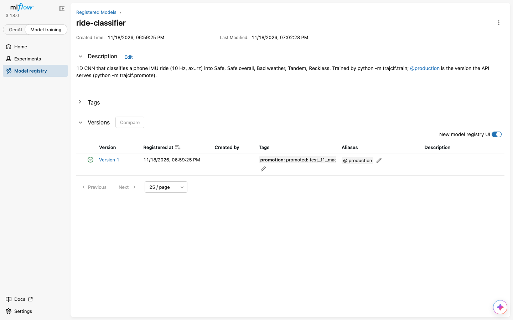
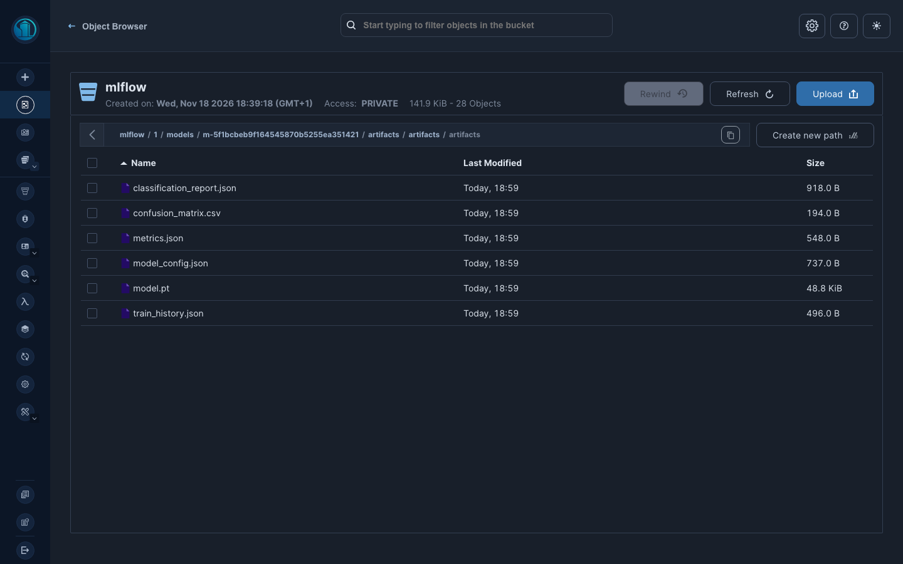
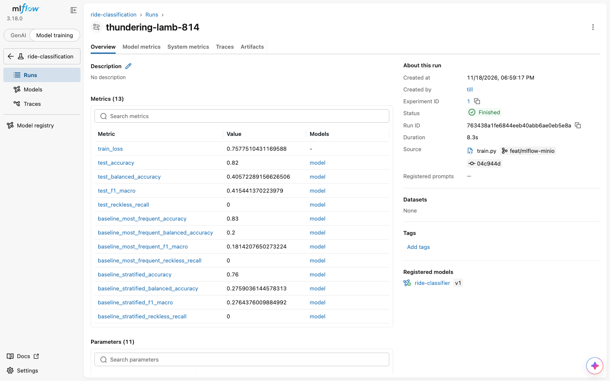
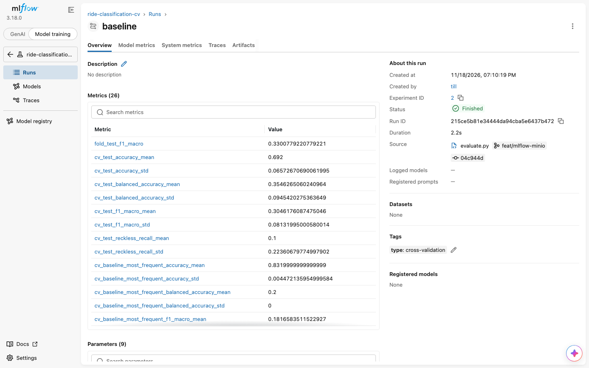

# MLflow + MinIO

Experiment tracking and model registry for the project, running locally with Docker Compose.

| Service | Role | URL on your machine |
|---|---|---|
| `mlflow` | tracking server, model registry, artifact proxy | <http://localhost:5050> |
| `minio` | S3-compatible storage for artifacts (model files, reports) | console <http://localhost:9001>, API `localhost:9000` |
| `postgres` | MLflow metadata (experiments, runs, params, metrics, registry) | not exposed |
| `minio-init` | one-shot job that creates the `mlflow` bucket | – |

```
python -m trajclf.train ──HTTP──▶ mlflow:5000 ──▶ postgres   (params, metrics, model versions)
API / Streamlit         ◀─HTTP──             └──▶ minio      (bucket "mlflow": model.pt, reports, ...)
```

Clients only talk to MLflow over HTTP (`--serve-artifacts`): the server uploads and downloads
artifacts to MinIO for them. **Only `MLFLOW_TRACKING_URI` is needed** on the client side, no S3
credentials.

Project objectives covered here:

- **Store the model on S3 (MinIO)**: every trained model (`model.pt`, its config and reports) is written to
  the `mlflow` bucket in MinIO.
- **Track models and experiments with MLflow**: params, loss curve, test metrics against baselines and
  cross-validation are logged per run; every training registers a new version of `ride-classifier`, and
  `@production` marks the version the API serves, with the reason of each promotion stored on the version.

## Screenshots

Real GBG500 run (hold-out test: macro-F1 0.42 vs 0.18 "always Safe" and 0.28 random).

| Model registry: `@production` alias, promotion reason | Model files in the MinIO bucket |
|---|---|
|  |  |
| **Training run: test metrics vs baselines, git commit** | **5-fold cross-validation run** |
|  |  |

## Start

Requires Docker Desktop.

```bash
cp .env.example .env          # once; change the passwords (letters and digits only)
docker compose up -d          # first run downloads the images and builds MLflow (a few minutes)
docker compose ps             # mlflow, minio, postgres "healthy"; minio-init "exited (0)"
```

Check that everything works (logs a test run, reads the file back through MinIO, lists models):

```bash
export MLFLOW_TRACKING_URI=http://localhost:5050
python scripts/check_mlflow.py
```

Stop with `docker compose down`. Runs and models are kept in the Docker volumes `ride-mlops_postgres-data`
and `ride-mlops_minio-data`; `docker compose down -v` deletes them (fresh start).

## Log runs and register the model

```bash
export MLFLOW_TRACKING_URI=http://localhost:5050
python -m trajclf.data                                       # once, needs data/raw/
python -m trajclf.train --register-name ride-classifier      # experiment "ride-classification"
python -m trajclf.evaluate --run-name baseline               # experiment "ride-classification-cv"
python -m trajclf.promote                                    # move @production if the new version is better
```

Each training run logs params, the loss curve, test metrics and baselines, the report files
(`reports/`) and a pyfunc model, and creates a new version of `ride-classifier`.

## Promote a version to production (alias)

The API never hard-codes a version number: it loads `models:/ride-classifier@production`. After
training, move that alias with:

```bash
python -m trajclf.promote                 # newest version, only if it passes the checks below
python -m trajclf.promote --version 3     # manual choice or rollback, no checks
```

The newest version becomes `@production` only if, on its hold-out test rides, its macro-F1
(`--metric balanced_accuracy` to change)

1. beats both baselines logged in the same run ("always Safe" and random), and
2. is at least as good as the current `@production` version.

Otherwise production stays where it is and the command says why. The replaced version gets the alias
`previous`, so rolling back is `--version <previous>`. Retraining (monitoring part) can run
`train --register-name ride-classifier` then `promote` without touching the API.

Aliases can also be set by hand in the UI (Models → `ride-classifier` → version → Aliases).
The comparison with production is fair only while both versions were tested on the same hold-out rides
(same `data/processed` split).

## Load the model (API, Streamlit, monitoring)

```python
import mlflow

model = mlflow.pyfunc.load_model("models:/ride-classifier@production")   # or "models:/ride-classifier/1"
model.predict(df)   # columns ax..rz (+ optional ride_id) → label + one probability per class
```

To get the plain `RideClassifier` (raises `DataValidationError` on bad input, useful for HTTP 422):

```python
clf = mlflow.pyfunc.load_model("models:/ride-classifier@production").unwrap_python_model().clf
clf.predict(df)   # {"label": ..., "probabilities": {...}, "n_windows": ...}
```

Loading the model needs the project's Python dependencies (`pip install -e ".[mlflow]"`, which
brings PyTorch), not just `mlflow`.

Tracking URI to use:

| Where the code runs | `MLFLOW_TRACKING_URI` |
|---|---|
| your laptop | `http://localhost:5050` |
| a container in this Compose project | `http://mlflow:5000` |
| Kubernetes | the MLflow Service name and port (add that name to `MLFLOW_ALLOWED_HOSTS`) |

## Where things are stored

- **MinIO** bucket `mlflow` (browse it in the console, log in with `MINIO_ROOT_USER` / `MINIO_ROOT_PASSWORD`
  from `.env`): `<experiment id>/<run id>/artifacts/reports/...` and `<experiment id>/models/<model id>/artifacts/...`.
- **Postgres** database `mlflow`: everything shown in the MLflow UI except files.

## Troubleshooting

| Problem | Fix |
|---|---|
| `localhost:5000` answers "403" or nothing | That is macOS AirPlay Receiver. MLflow is on **5050** (`MLFLOW_PORT` in `.env`). |
| `required variable ... copy .env.example to .env` | `cp .env.example .env` |
| Port already in use | change `MLFLOW_PORT`, `MINIO_API_PORT` or `MINIO_CONSOLE_PORT` in `.env` |
| Changed passwords in `.env` but login fails | the old ones are stored in the volumes: `docker compose down -v` (deletes runs) |
| Something is unhealthy | `docker compose logs mlflow` (or `minio`, `postgres`, `minio-init`) |

## Notes

- Versions are pinned: MLflow server **3.18.0** (`docker/mlflow/Dockerfile`), Postgres 17.11, MinIO
  `RELEASE.2026-08-04`. Keep the `mlflow` Python package on the same minor version as the server.
- The official `minio/minio` Docker image is no longer published, so the stack uses
  [`pgsty/minio`](https://hub.docker.com/r/pgsty/minio), the maintained community build of MinIO (same
  `minio` server and S3 API; its web console is branded "SILO").
- Ports are bound to `127.0.0.1` only: the stack is not reachable from the network.
