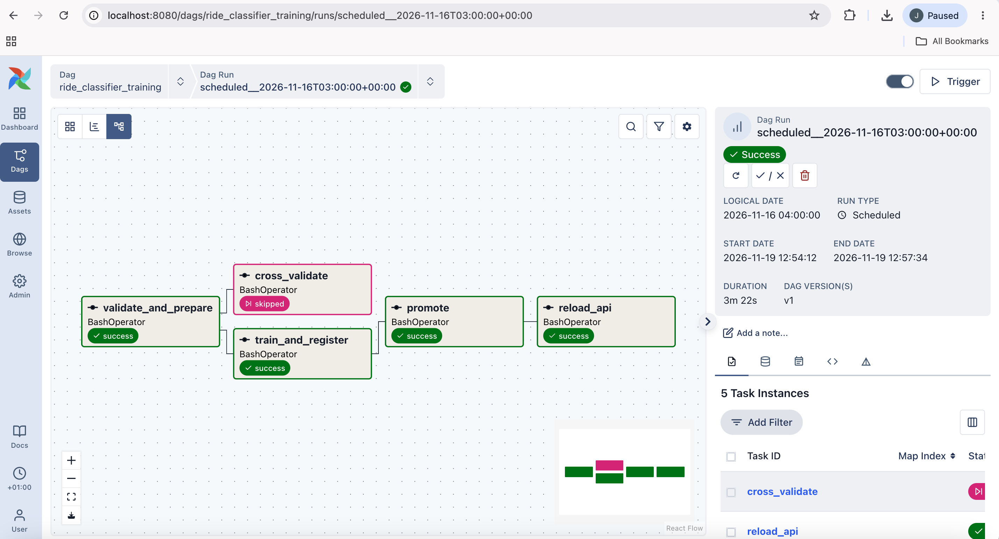

# Training pipeline (Airflow DAG)

The DAG `ride_classifier_training` retrains the model and puts it in production only if it is better.

```
validate_and_prepare ─▶ train_and_register ─▶ promote ─▶ reload_api
                   └──▶ cross_validate   (optional)
```

| Task | What it does | Result |
|---|---|---|
| `validate_and_prepare` | Data quality gate (schema, 10 Hz sampling, missing values, physical ranges, labels), then clean and split by ride | **fails the run** on bad data: no training on broken data |
| `train_and_register` | Train the CNN with `params.yaml`, evaluate on hold-out rides against the "always Safe" and random baselines, log params / metrics / model to MLflow, register a new version of `ride-classifier` | new registry version |
| `promote` | Move `@production` to the new version **only if** it beats both baselines **and** the current production (`trajclf.promote`) | **skipped** (not failed) if the model is not better |
| `reload_api` | `POST /model/reload` so the API serves the new `@production` version, without restart | skipped when `promote` is skipped |
| `cross_validate` | 5-fold CV logged in the `ride-classification-cv` experiment | runs only when the `cross_validate` param is true (about 5x training time) |

Schedule: every Monday at 03:00, and on demand with **Trigger DAG**. Run parameters: `cross_validate`
(bool) and `epochs` (override `params.yaml`, e.g. 2 for a quick test run).

## Run it

Requires the dev stack (MLflow + MinIO + Postgres) and the data in `data/raw/`.

```bash
cp .env.example .env                       # once (adds AIRFLOW_PORT, PIPELINE_API_URL, RELOAD_TOKEN)
docker compose --profile airflow up -d     # first time: builds the Airflow image (~5-10 min, PyTorch CPU)
docker compose ps                          # wait for airflow "healthy" (~1 min)
```

Open <http://localhost:8080> → DAG `ride_classifier_training` → **Trigger** (first try with `epochs: 2`).
To also reload the API at the end, keep the API running on your laptop
(`uvicorn api.main:app --app-dir src --port 8000`, with `MLFLOW_TRACKING_URI=http://localhost:5050`).

Without Airflow, the same steps run from the terminal:

```bash
export MLFLOW_TRACKING_URI=http://localhost:5050 API_URL=http://localhost:8000
python -m trajclf.pipeline all              # prepare → train → promote → reload
python -m trajclf.pipeline promote          # one step; exit code 99 = production unchanged
```

## Design choices

- **One source of truth for the steps.** The logic lives in `src/trajclf/pipeline.py` (plain functions and a
  CLI). The DAG only orders the steps and calls `python -m trajclf.pipeline <step>`, so the same steps run in
  Airflow, by hand, or from a GitHub Actions retraining job, and are tested without Airflow
  (`tests/test_pipeline_dag.py`, including a full run against a local MLflow store).
- **Airflow and the ML stack do not share a Python environment.** The Airflow image installs PyTorch, MLflow
  and the rest in `/opt/project-venv`; Airflow's own pinned dependencies are untouched. The code is mounted, not
  copied, so a change to `src/` or `dags/` is picked up without rebuilding.
- **A model that is not better is a normal outcome, not an error.** `promote` exits with code 99, which Airflow
  shows as *skipped*; production and the API stay on the current version.
- **Promotion rules live in one place** (`trajclf.promote`), shared by the DAG and manual promotions, and every
  decision is written on the model version in the registry (tag `promotion`).
- Each task prints its result as JSON on its last line, which Airflow keeps as the task's XCom (visible in the UI).

## Tested

| What | How |
|---|---|
| Steps end to end (prepare → train → register → promote → reload) | `pytest tests/test_pipeline_dag.py` (local MLflow store) |
| DAG structure (dependencies, skip on "not promoted", one step per task) | `pytest tests/test_airflow_dag.py` (runs where Airflow is installed) |
| Full DAG with Airflow 3.4 against a live MLflow server and the live API | `airflow dags test ride_classifier_training -c '{"epochs": 2}'`: run 1 promoted v1 and the API reloaded it; run 2 (worse model) skipped `promote` and `reload_api`, API stayed on v1 |

## In production: GitHub Actions

In production the same steps run from the `retrain` GitHub Actions workflow on the self-hosted runner, as a
Kubernetes Job (`k8s/train-in-cluster.sh`): manually, weekly, or when a drift is detected. See
[cicd.md](cicd.md#retraining-workflow) and the drift alerts in [monitoring.md](monitoring.md).

## Airflow on Kubernetes (not deployed)

Airflow could also run in the cluster (official Airflow Helm chart or a single `airflow standalone`
Deployment), with `MLFLOW_TRACKING_URI` and `API_URL` pointing at the MLflow and API Services, and `RELOAD_TOKEN`
from the same Secret as the API. The raw data must be on a volume mounted at `/opt/project/data/raw`.

## Screenshot



If a task fails with `return code -9`, Docker ran out of memory: raise it in Docker Desktop → Settings → Resources → Memory (6–8 GB).
